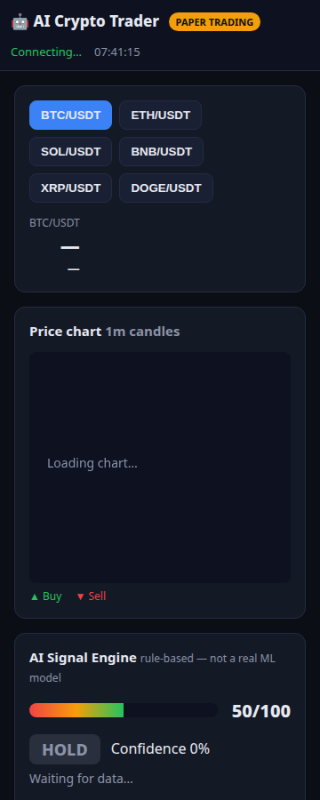
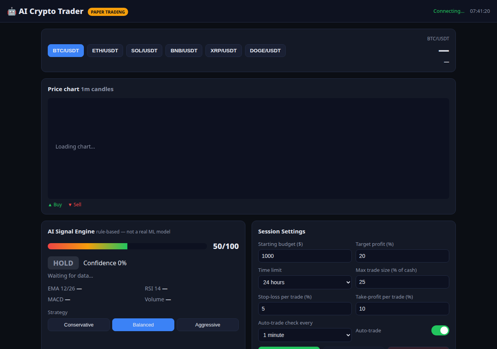

<div align="center">

# ai-crypto-trader

**Paper trading, live prices, honest signals. No real money.**

Set a budget and a target, let a rule-based signal engine trade on live Binance prices — or trade manually. See whether you beat your starting capital before the clock runs out.

**🚀 [Try the live app — see it in action](https://ai-crypto-trader-6f1vtvwa8-ggq3.vercel.app)**

Paper trading only. Not financial advice.

[](https://github.com/smabdulmueid97/ai-crypto-trader/blob/main/LICENSE)
[](https://github.com/smabdulmueid97/ai-crypto-trader/stargazers)
[](https://github.com/smabdulmueid97/ai-crypto-trader/commits/main)

</div>

---

## Screenshots

| Mobile | Desktop |
|---|---|
|  |  |

> Tested at 360 / 768 / 1280 px — no horizontal overflow, no clipped buttons.

---

## What it does

- **Live prices** — BTC, ETH, SOL, BNB, XRP, DOGE from Binance (CoinGecko fallback), with a 1-minute candle chart and buy/sell markers
- **Rule-based signal engine** — EMA 12/26 + RSI 14 + MACD + volume → a 0–100 score and a BUY / SELL / HOLD signal, with the reason shown. Labelled honestly in the UI: this is rules, not a real ML model
- **Your session, your rules** — starting budget, target profit %, time limit (1h / 24h / 7d / 30d / custom), max trade size, stop-loss, take-profit, and Conservative / Balanced / Aggressive strategy presets
- **Auto-trade or manual** — auto-trade checks every 30 s / 1 min / 5 min, or hit Buy / Sell yourself while a session runs
- **Win / loss banner** — session ends on target hit, capital stop-loss, or time limit, and says so plainly
- **Portfolio + trade history** — P&L, win rate, fees paid (0.1% per trade), full log, saved in localStorage

## Run it locally

```bash
# any static server, e.g.
npx serve .
# or just open index.html in a browser
```

No build step, no API keys, no backend.

## How it works

1. Set your budget, target, and time limit — then Start.
2. The signal engine scores the market 0–100 on every check and buys or sells within your size, stop-loss, and take-profit limits.
3. Watch the portfolio: current value, P&L, progress to target, trade history.
4. Session ends when you hit the target, hit the stop-loss, or run out of time.

## Related repos

- [ai-cost-calculator](https://github.com/smabdulmueid97/ai-cost-calculator) — estimate LLM API costs before you ship, compare 9 models side by side

## License

MIT
